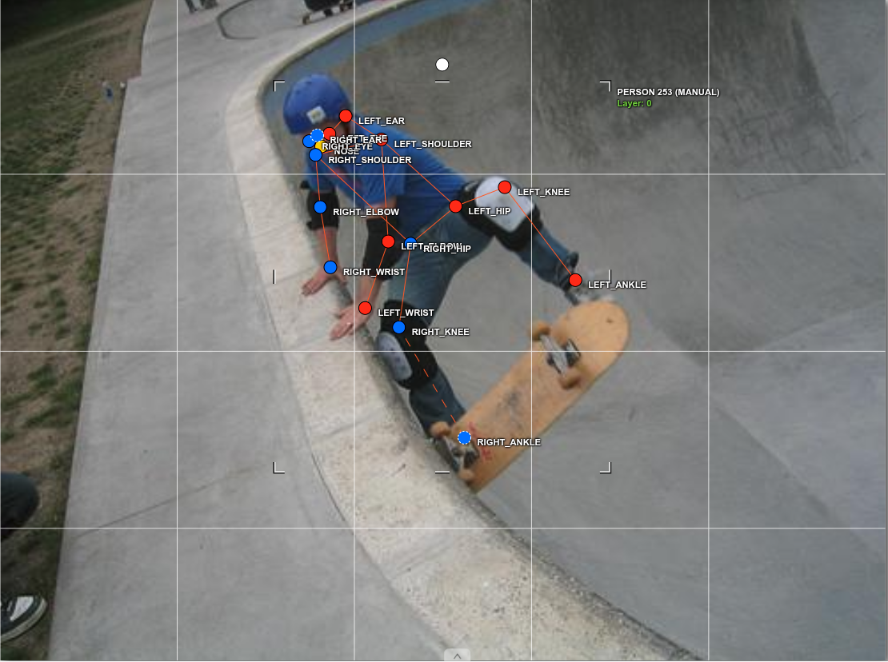
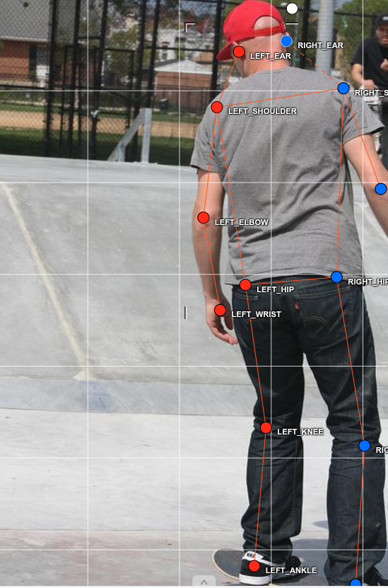
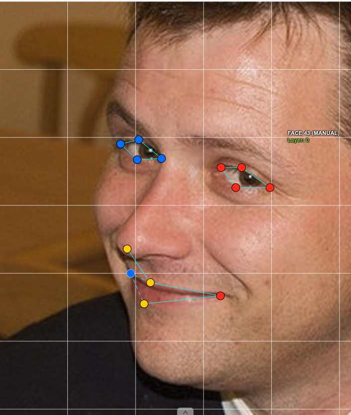
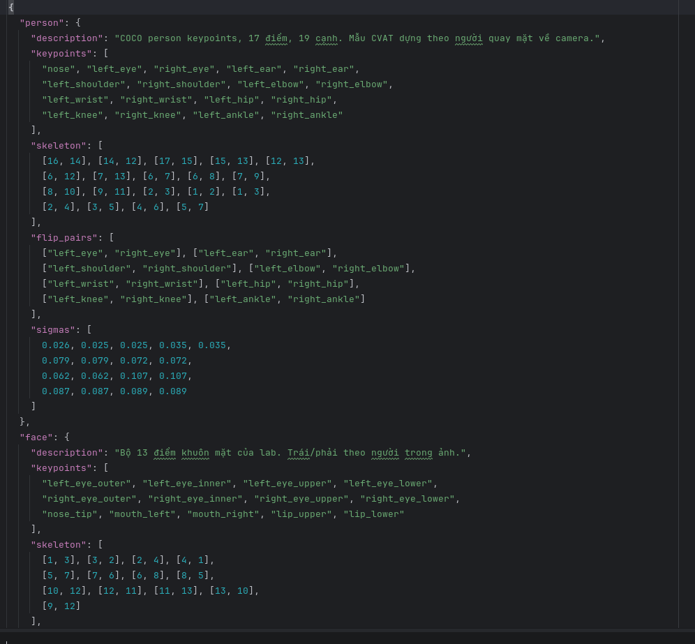

# Báo cáo cá nhân — NguyenVietQuang-2A202603056

Đổi tên file theo quy tắc `2A202603056-NguyenVietQuang.md`. Ví dụ: `20241234_NguyenVanAn.md`.

Dữ liệu: 12 ảnh người COCO 2017 và 8 ảnh cắt khuôn mặt từ ảnh COCO 2017, chỉ dùng trong lớp.

## 0. Thông tin học viên

- Họ tên: Nguyễn Việt Quang
- MSSV: 2A202603056
- Email: nguyenvietquang25032001@gmail.com
- Link repository: https://github.com/quangts2531/K5-L2-DAY04-NguyenVietQuang-2A202603056-KeypointPose-Student.git
- Phiên bản CVAT (Help → About):
- Máy: hệ điều hành Linux · RAM 22 GB · chạy CVAT chế độ đầy đủ / lite
- Bộ ảnh (`src/exports/assignment.json` do `lab.py setup` tạo): Có
- Giờ bắt đầu: 4 PM ngày 12/11
- Giờ kết thúc: 8PM ngày 12/11

## 1. Kiểm tra label (CP0)

| Label | Kiểu | Số điểm | Tên điểm đúng bảng của lab? | Đúng thứ tự? | Số cạnh |
|---|---|---:|---|---|---:|
| `person` | skeleton | 17 | Theo cấu hình `labels_d04_keypoint.json`; chưa đối chiếu trên CVAT | Chưa xác nhận | 19 |
| `face` | skeleton | 13 | Theo cấu hình `labels_d04_keypoint.json`; chưa đối chiếu trên CVAT | Chưa xác nhận | 13 |

Mẫu `person` dựng theo người quay mặt về camera (các điểm `left_*` nằm bên phải khung mẫu)? Có / Không

Cách đổi cờ `occluded` / `outside` cho **một điểm** trên phiên bản CVAT này (một câu):

...

## 2. Số lượng đã gán và thời gian (CP1, CP2)

| Nhóm ảnh | Số ảnh | Số skeleton đã gán | Số người dưới 60 px (không gán) | Số poster / gương / màn hình bỏ qua | Thời gian (phút) |
|---|---:|---:|---:|---:|---:|
| `easy` | 5 | 5 | 2 | 0 | 10 |
| `occluded` | 3 | 6 | 1 | 1 | 6 |
| `back` | 2 | 3 | 1 | 1 | 6 |
| `small` | 1 | 1 | 2 | 2 | 2 |
| `crowd` | 1 | 3 | 0 | 0 | 2 |
| `faces` | 8 | 8 | — | 0 | 16 |

Cột **Thời gian (phút)** là tổng thời gian bạn dành để gán nhãn cho các ảnh thuộc nhóm đó.

- Số ảnh người đã xong ở mốc phút 105: 10 / 10
- Thời gian thực tế (phút): CP1 26 · CP2 16 · CP3 chưa ghi nhận
- Ảnh tốn thời gian nhất là ảnh nào, vì sao? `000000542160.jpg` — có nhiều đối tượng và một số điểm không rõ ràng.

...

## 3. Bảng ca khó (CP1, CP2)

Mỗi điểm bạn phân vân một dòng, nhất là phân vân giữa `v = 1` và `v = 0`, hoặc không chắc hướng người.

| Ảnh | Người / mặt | Điểm | Cờ đã chọn | Phân vân giữa | Lý do chọn |
|---|---|---|---:|---|---|
| `000000542160.jpg` #3 | person | Cặp mắt/hông so với gối/cổ chân | — (cảnh báo `lr_swap`, không phải cờ visibility) | Trái/phải chưa nhất quán | Script cảnh báo các cặp điểm này không nhất quán; cần kiểm tra lại trên ảnh/CVAT. |
| `000000183176.jpg` | person bị khuất | Chỉ còn vài điểm nhìn thấy | ko có | Khó nhận diện điểm vì người bị che, chỉ lộ vài điểm | Cần xem kỹ để phân biệt điểm nào còn quan sát được và điểm nào không thể xác định. |
| `000000311497.jpg` #2 | person | Cặp vai/hông so với gối/cổ chân | — (cảnh báo `lr_swap`, không phải cờ visibility) | Trái/phải chưa nhất quán | Script cảnh báo các cặp điểm này không nhất quán; cần kiểm tra lại trên ảnh/CVAT. |

## 4. Bảng tự review (CP3)

Đi từ ảnh cuối về ảnh đầu. 5 ảnh người (ít nhất 2 ảnh `back` hoặc `crowd`) và 3 ảnh mặt. Ít nhất 8 dòng, kể cả dòng `ok`. Ghi lỗi trước, sửa sau.

Mã lỗi dùng đúng một trong: `lr_swap`, `vis_flag`, `position`, `missing`, `extra`, `ok`.

| Ảnh | Người / mặt | Điểm | Mã lỗi | Ghi chú | Đã sửa? |
|---|---|---|---|---|---|
| `000000311497.jpg` #2 | person | Trái/phải vai, hông so với gối, cổ chân | `lr_swap` | Script cảnh báo trái/phải không nhất quán; cần đối chiếu trên ảnh/CVAT | Chưa xác nhận |
| `000000542160.jpg` #3 | person | Trái/phải mắt, hông so với gối, cổ chân | `lr_swap` | Script cảnh báo trái/phải không nhất quán; cần đối chiếu trên ảnh/CVAT | Chưa xác nhận |
| `000000056651.jpg` #1 | person | `right_hip` | `vis_flag` | Không thể xác định vị trí điểm | Đã đánh dấu `outside`; export đang ghi `v = 0`. |
| `000000019754.jpg` #1 | person | `right_hip` | `vis_flag` | Không thể xác định vị trí điểm, trường hợp tương tự ảnh `000000056651.jpg` | Chưa xác nhận: export hiện vẫn ghi `v = 2`; cần kiểm tra/sửa lại trên CVAT. |


Tổng hợp số lỗi theo mã:

| `lr_swap` | `vis_flag` | `position` | `missing` | `extra` | `ok` |
|---:|---:|---:|---:|---:|---:|
| 2 | 2 | 0 | 0 | 0 | 0 |

Ghi chú: hai trường hợp `lr_swap` là cảnh báo tự kiểm và vẫn cần đối chiếu trực tiếp trên CVAT; số `vis_flag` là hai điểm `right_hip` đã ghi nhận xử lý ở trên.

Điểm còn phân vân giữa `v = 1` và `v = 0` (ghi cả hai lựa chọn và lý do chọn):

...

## 5. Kiểm file xuất và kết quả tự kiểm (CP4)

Tự kiểm tay trong file JSON:

| File | Người / mặt kiểm (ảnh, thứ tự) | Số phần tử `keypoints` | Điểm `outside` ra `v = 0`, `occluded` ra `v = 1`? | `num_keypoints` khớp? |
|---|---|---:|---|---|
| `NguyenVietQuang_persons.zip` | `000000056651.jpg` #1 | 51 | `right_hip` có `v = 0` như điểm outside; annotation có cả `v = 1` | Có: `num_keypoints` 11 khớp 11 điểm `v > 0` |
| `NguyenVietQuang_persons.zip` | `000000542160.jpg` #3 | 51 | Annotation có cả `v = 0` và `v = 1`; giao diện CVAT chưa đối chiếu | Có: `num_keypoints` 13 khớp 13 điểm `v > 0` |
| `NguyenVietQuang_faces.zip` | `face_309728.jpg` #1 | 39 | Có `v = 1`; không có `v = 0` trong annotation này | Có: `num_keypoints` 13 khớp 13 điểm `v > 0` |

Đã kiểm tra toàn bộ JSON: 18/18 annotation person có 51 số keypoint, 8/8 annotation face có 39 số; `num_keypoints` khớp số điểm `v > 0` trong tất cả annotation. Export có 37 điểm `v = 1` và 65 điểm `v = 0` ở person; face có 17 điểm `v = 1`, không có `v = 0`. CVAT 2.x vẫn giữ tọa độ cũ cho điểm `v = 0` theo ghi chú của script. Mapping cờ trên giao diện CVAT chưa được đối chiếu độc lập qua JSON.

Hai job đã chuyển sang completed trên CVAT? Có — đã bấm **Finish the job**.

Dán phần **TÓM TẮT** in ra từ `src/check_submission.py`:

```text
- File person: NguyenVietQuang_persons.zip
  Số ảnh: 12 · số skeleton `person`: 18 · mỗi annotation 51 số
  Skeleton theo ảnh: 000000019754=1, 000000056651=2, 000000069971=2, 000000150192=1, 000000183176=2, 000000241837=1, 000000311497=2, 000000359340=1, 000000399983=1, 000000431893=1, 000000455536=1, 000000542160=3
  Cờ v: v=2 204 (67%) · v=1 37 (12%) · v=0 65 (21%)
  num_keypoints trung bình: 13.4
- File face: NguyenVietQuang_faces.zip
  Số ảnh: 8 · số skeleton `face`: 8 · mỗi annotation 39 số
  Skeleton theo ảnh: face_309728=1, face_3348=1, face_380639=1, face_415073=1, face_442231=1, face_504911=1, face_559185=1, face_560282=1
  Cờ v: v=2 87 (84%) · v=1 17 (16%) · v=0 0 (0%)
  num_keypoints trung bình: 13.0
- Ghi chú: 65 điểm v = 0 vẫn mang tọa độ cũ (CVAT 2.x xuất như vậy; chuẩn COCO ghi 0, 0). Không phải lỗi: điểm v = 0 bị bỏ qua khi huấn luyện và khi chấm.
- Số [LỖI]: 0 · số [CẢNH BÁO]: 2
Kết quả: ĐẠT (đọc lại từng cảnh báo ở trên)
```

Các `[CẢNH BÁO]` cần review:

- `000000311497.jpg` #2: trái/phải không nhất quán giữa các cặp điểm (shoulder, hip so với knee, ankle).
- `000000542160.jpg` #3: trái/phải không nhất quán giữa các cặp điểm (eye, hip so với knee, ankle).
- Chưa có thông tin xác nhận đã kiểm tra/sửa hai cảnh báo này.

## 6. Ảnh chụp màn hình

1. Skeleton `person` đã gán:

   

2. Người quay lưng đã gán:

   

3. Một khuôn mặt đã gán 13 điểm, phóng to vùng mắt:

   

4. JSON hiển thị định nghĩa category `person` (keypoints và skeleton):

   

   Ảnh này hiện hiển thị phần `categories`, chưa thấy annotation của một người với mảng `keypoints` và trường `num_keypoints`; cần thay bằng ảnh chụp đúng đoạn annotation export để đáp ứng yêu cầu mục 6.

Nguồn ảnh: COCO 2017 (ảnh người và ảnh cắt khuôn mặt).

## 7. Tự đánh giá

1. Lỗi/rủi ro mình cần chú ý nhất hôm nay, và cách tránh ở dự án thật:

   Các cảnh báo trái/phải cho thấy mình cần rà kỹ tính nhất quán giữa vai, hông, gối và cổ chân, nhất là khi ảnh có nhiều người hoặc tư thế khó nhìn. Trước khi chốt nhãn, mình sẽ xác định trái/phải theo cơ thể người trong ảnh rồi kiểm tra lại từng cặp khớp cùng bên. Mình chưa thống kê đủ để kết luận đây là lỗi mắc nhiều nhất.

2. Một quy tắc bạn đề xuất thêm vào guideline (kèm ảnh ví dụ nếu có):

   Với người bị che, chỉ gán tọa độ cho khớp khi có thể xác định vị trí đủ tin cậy. Nếu không xác định được thì giữ node trong skeleton và đặt `outside` (`v = 0`), không đoán vị trí và không xóa node. Sau đó rà lại trái/phải theo chuỗi vai–khuỷu–cổ tay và hông–gối–cổ chân.

3. Nhãn của bạn đi vào model ở đâu? Chọn một lỗi bạn đã sửa và nói nó sẽ làm model học sai thế nào (heatmap, trọng số trong loss, hay bước lật ảnh):

   Ở `000000056651.jpg` #1, `right_hip` không xác định được nên đã đánh dấu `outside` (`v = 0`). Nếu mình giữ một tọa độ đoán bừa với `v > 0`, điểm đó sẽ tạo mục tiêu heatmap sai và đóng góp sai vào loss. Với `v = 0`, điểm không được tính làm mục tiêu giám sát. Export hiện ghi điểm này là `v = 0`.

## 8. Khó khăn và lỗi kỹ thuật

Khó khăn chính là nhận diện keypoint khi người bị che hoặc ảnh có nhiều đối tượng. Ở `000000183176.jpg`, một người chỉ lộ vài điểm nên khó xác định khớp; ở `000000056651.jpg` #1, `right_hip` không xác định được và được đánh dấu `outside` (`v = 0`). Ảnh `000000542160.jpg` có nhiều đối tượng và một số điểm không rõ ràng nên tốn thời gian nhất. Script cũng còn cảnh báo trái/phải ở `000000311497.jpg` #2 và `000000542160.jpg` #3; cần kiểm tra lại trên CVAT. Riêng `000000019754.jpg` #1, báo cáo trước ghi đã xử lý `right_hip`, nhưng export hiện vẫn cho `v = 2`, nên trạng thái cần được đối chiếu.

Lỗi kỹ thuật khi chạy `python lab.py export`: chưa ghi nhận. Lần chạy gần nhất đăng nhập CVAT thành công, tạo được hai file ZIP và tự kiểm kết quả **ĐẠT**, 0 lỗi và 2 cảnh báo dữ liệu như trên.

## Bonus (nếu làm)

### B1 — 3 ảnh người khó thêm

| Ảnh | Số skeleton | Số người dưới 60 px | Ca khó nhất |
|---|---:|---:|---|
| | | | |
| | | | |
| | | | |

Kết quả `src/check_submission.py` cho `HoVaTen_bonus_persons.zip`:

```text
(dán ở đây)
```

### B2 — 5 ảnh khuôn mặt đen trắng / hồng ngoại

Ảnh không màu khó hơn ở điểm nào? Kính râm trên ảnh hồng ngoại có còn là `v = 1` không?

...

### B3 — Model so với nhãn của tôi (không tính điểm)

- Demo đã dùng:
- Ảnh đã thử:

1. Model có trả điểm cho khớp bị che, hay khớp ngoài ảnh không? Confidence ở các điểm đó thế nào?

   ...

2. Với người quay lưng, model có đổi trái/phải không?

   ...

3. Bộ điểm của model có giống 17 điểm COCO không?

   ...

## 9. Tài liệu tham khảo và công cụ AI đã dùng

- Lin et al., *Microsoft COCO: Common Objects in Context* (2014); ảnh dùng theo danh sách nguồn trong `src/lab/NGUON_ANH.md` và `src/lab/pool.json`.
- OpenAI Codex: hỗ trợ rà soát yêu cầu nộp và cập nhật báo cáo từ output export do học viên cung cấp.
